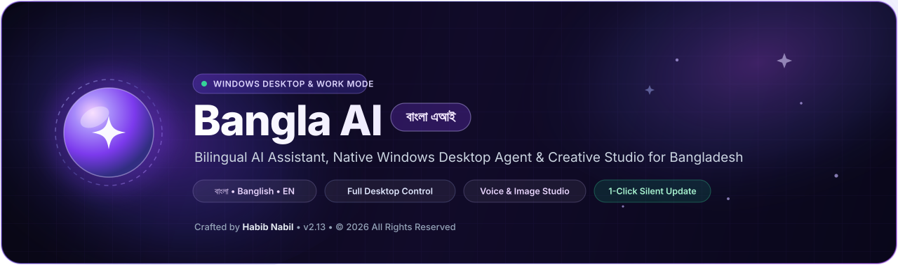

<div align="center">
  

  <br /><br />

  <p>
    <a href="https://github.com/Habib83205/bangla-ai/releases/latest">
      
    </a>
    
    
    <a href="./LICENSE">
      
    </a>
    <a href="https://github.com/Habib83205">
      
    </a>
  </p>

  <p>
    <strong>A next-generation bilingual AI assistant and native Windows Desktop Work Mode agent engineered for Bangladesh.</strong><br />
    Chat effortlessly in <strong>বাংলা</strong>, <strong>Banglish</strong>, and <strong>English</strong> — automate desktop apps, manage files, generate images, speak naturally, and receive 1-click silent updates.
  </p>

  <p>
    <a href="#-download-windows-desktop-app"><strong>Download (.exe)</strong></a> •
    <a href="#-key-features"><strong>Features</strong></a> •
    <a href="#-work-mode-permission-tiers"><strong>Work Mode</strong></a> •
    <a href="#-developer-quick-start"><strong>Development</strong></a> •
    <a href="#-security--privacy"><strong>Security</strong></a> •
    <a href="#%EF%B8%8F-copyright-license--legal-notice"><strong>Legal &amp; Copyright</strong></a>
  </p>
</div>

---

## 📥 Download Windows Desktop App

> [!TIP]
> **1-Click Silent Installer & Auto-Update:** Download and run **`BanglaAi v2.9.exe`** once. Every future release automatically checks for updates and installs **100% silently** with a single permission click — zero setup wizards required.

| Channel | Package | Direct Access |
| :--- | :--- | :--- |
| **Direct Installer (Latest)** | `BanglaAi v2.9.exe` (Windows x64) | [**Download BanglaAi v2.9.exe**](https://github.com/Habib83205/bangla-ai-releases/releases/latest/download/BanglaAi.v2.9.exe) |
| **Repository Releases** | Versioned `.exe` + release notes | [**Habib83205/bangla-ai/releases**](https://github.com/Habib83205/bangla-ai/releases/latest) |
| **Public Auto-Update Feed** | Silent update feed (`latest.yml`) | [**Habib83205/bangla-ai-releases**](https://github.com/Habib83205/bangla-ai-releases/releases/latest) |
| **In-Repo Binary (Git LFS)** | Tracked in project root | [**`./BanglaAi v2.9.exe`**](./BanglaAi%20v2.9.exe) |

---

## ✨ Key Features

<table>
  <tr>
    <td width="50%" valign="top">
      <h3>🇧🇩 True Bilingual Intelligence</h3>
      <ul>
        <li>Fluent across <strong>Shuddho বাংলা</strong>, <strong>Banglish</strong>, and <strong>English</strong>.</li>
        <li>Tailored for Bangladeshi context: BDT (৳), SSC/HSC/BCS &amp; University prep, tech, and business workflows.</li>
        <li>Instant <strong>বাংলা / EN</strong> interface switching with <strong>Cosmic Violet Light &amp; Dark</strong> themes.</li>
      </ul>
    </td>
    <td width="50%" valign="top">
      <h3>🖥️ Native Windows Work Mode Agent</h3>
      <ul>
        <li>Automate <strong>any installed Windows software</strong> (WhatsApp, Telegram, Discord, Chrome, Arc, Edge, Word, Excel, VS Code, Notepad, File Explorer, Spotify, VLC, and more).</li>
        <li>Full local file &amp; drive access (<code>C:\</code>, <code>D:\</code>, <code>E:\</code>), PowerShell execution, clipboard, volume/media, and live screen capture.</li>
        <li>Global quick-summon hotkey: press <code>Alt + Space</code> from anywhere in Windows.</li>
      </ul>
    </td>
  </tr>
  <tr>
    <td width="50%" valign="top">
      <h3>🎨 AI Image Studio &amp; Natural Voice</h3>
      <ul>
        <li>Built-in <strong>Image Studio</strong> with customizable aspect ratios (<code>1:1</code>, <code>16:9</code>, <code>9:16</code>, <code>4:3</code>) and 1-click download.</li>
        <li>Hands-free <strong>Voice Input</strong> (বাংলা &amp; English speech recognition) and natural AI Voice read-back.</li>
        <li><strong>Deep Think</strong> reasoning mode + <strong>Smart Live Web Search</strong> with source citations.</li>
      </ul>
    </td>
    <td width="50%" valign="top">
      <h3>⚡ Seamless Desktop Experience</h3>
      <ul>
        <li><strong>Zero-friction 1-Click Silent Updates</strong> with permission-first prompts and real-time progress bar.</li>
        <li><strong>Per-PC User Profiles</strong>, custom Workspaces, Prompt Library, Archived Chats, and Export (<code>.md</code>, <code>.json</code>, <code>.html</code>).</li>
        <li>Minimize to <strong>Windows System Tray</strong> for instant always-ready productivity.</li>
      </ul>
    </td>
  </tr>
</table>

---

## 🛡️ Work Mode Permission Tiers

Bangla AI Work Mode gives users complete control over how desktop actions are authorized:

| Permission Tier | Behavior | Ideal For |
| :--- | :--- | :--- |
| ✋ **Ask for approval** | Prompts with an **Approve / Skip** card before editing files, opening apps, running PowerShell commands, or automating UI actions. | Maximum manual oversight |
| 🛡️ **Approve for me** | Automatically runs safe daily tasks (opening apps, typing, browsing, reading files) and asks approval only for file deletions or risky system mutations. | Balanced everyday productivity |
| ⚡ **Full access** | Unrestricted direct execution across desktop apps, browsers, messaging, PowerShell, and files without interruption. | Hands-free autonomous workflows |

---

## 🧱 Architecture & Tech Stack

| Layer | Technologies |
| :--- | :--- |
| **Desktop Shell** | Electron (Windows x64), Native System Tray, Global Hotkey (`Alt+Space`), Silent NSIS Auto-Updater (`electron-updater`) |
| **Frontend UI** | React 19, TypeScript, Vite, Tailwind CSS v4, Framer Motion, Lucide Icons, Markdown & Syntax Highlighting |
| **Local Automation Engine** | Express Local Bridge (`127.0.0.1`), Win32 / UI Automation, PowerShell (`-ExecutionPolicy Bypass`), Universal App Launcher |
| **Storage & Privacy** | Local-first profile, chat history, workspaces, and optional user configuration stored exclusively on the user's machine |

---

## 🚀 Developer Quick Start

> [!NOTE]
> Node.js **v20+** and Windows 10/11 (x64) are recommended for local desktop development and native Work Mode testing.

```bash
# 1. Clone the repository
git clone https://github.com/Habib83205/bangla-ai.git
cd bangla-ai

# 2. Install dependencies
npm install

# 3. Configure environment variables (optional overrides)
copy .env.example .env

# 4. Run Web Mode (API + Vite Frontend)
npm run dev

# 5. Run Native Windows Desktop App with Hot Reload
npm run desktop:dev
```

<details>
<summary><strong>📦 Building &amp; Publishing Desktop Releases</strong></summary>

<br />

```bash
# Build local Windows 1-Click Silent Installer (.exe)
npm run desktop:build

# Auto-increment version (if already released), build BanglaAi v<ver>.exe,
# and publish to both GitHub Releases feeds
npm run publish:update
```

The release publisher ([`scripts/publish-release.ps1`](./scripts/publish-release.ps1)) automatically ensures every update carries a new version number, generates `latest.yml` + `.blockmap` metadata, updates the root binary, and uploads assets cleanly for silent auto-updates.

</details>

---

## 🔒 Security & Privacy

- **Local-First Architecture:** Conversations, custom workspaces, memories, and personal preferences remain stored locally on the user's Windows device.
- **No Hardcoded Secrets:** `.env` files and private credentials are strictly excluded from version control and compiled desktop installers.
- **System Safety Guards:** Destructive OS-level commands (e.g., disk formatting, system directory wipes) are unconditionally blocked at the engine level, and file deletions move safely to the Windows Recycle Bin.
- For vulnerability reporting and full security guidelines, please read [**`SECURITY.md`**](./SECURITY.md).

---

## 👨‍💻 Developer

<div align="center">
  <table>
    <tr>
      <td align="center" width="100%">
        <br />
        <strong>Habib Nabil</strong><br />
        <sub>Creator, Lead Architect &amp; Maintainer of <strong>Bangla AI (বাংলা এআই)</strong></sub><br /><br />
        <a href="https://github.com/Habib83205">
          
        </a>
        <br /><br />
      </td>
    </tr>
  </table>
</div>

---

## ⚖️ Copyright, License & Legal Notice

> **Copyright © 2026 Habib Nabil. All Rights Reserved.**

- **Proprietary Software:** This repository, its source code, UI/UX design system, brand identity (**Bangla AI / বাংলা এআই**), desktop automation engine, and compiled binaries (`BanglaAi v*.exe`) are the exclusive intellectual property of **Habib Nabil**.
- **Restrictions:** Unauthorized copying, redistribution, resale, decompilation, reverse engineering, or commercial deployment of this software or any portion thereof without prior explicit written permission from **Habib Nabil** is strictly prohibited.
- **Legal Documentation:**
  - 📜 [**`LICENSE`**](./LICENSE) — Proprietary Software License & Copyright Grant
  - ⚖️ [**`LEGAL.md`**](./LEGAL.md) — Terms of Use, Trademarks, Privacy Guarantee & Disclaimer
  - 🛡️ [**`SECURITY.md`**](./SECURITY.md) — Security Policy & Responsible Disclosure

---

<div align="center">
  <sub>Built with pride in Bangladesh 🇧🇩 • Crafted by <strong>Habib Nabil</strong> • © 2026 Bangla AI (বাংলা এআই)</sub>
</div>
